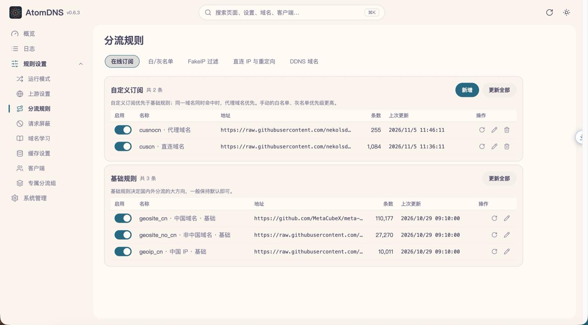
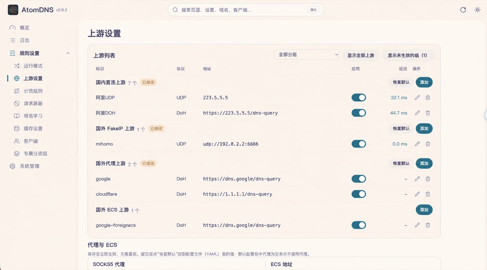
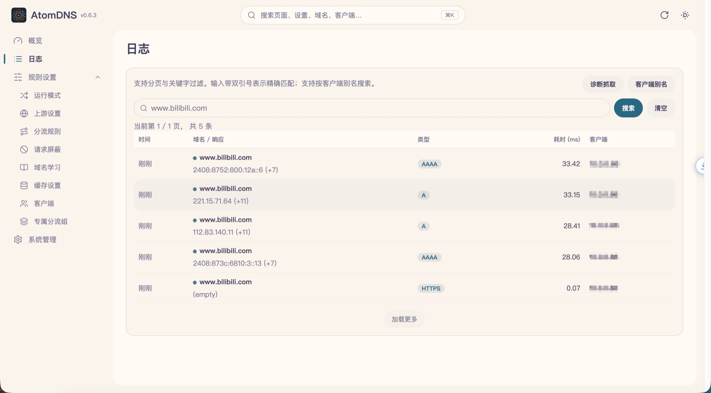

<p align="center"></p>

<h3 align="center">用 Rust 重写的 MosDNS：带完整 WebUI 的家庭网络 DNS 分流器</h3>

<p align="center">
  <a href="https://github.com/jasonxtt/atomdns/releases"></a>
  <a href="https://hub.docker.com/r/jasonxtt/atomdns"></a>
  
  
  <a href="LICENSE"></a>
</p>

<p align="center"><b><a href="https://jasonxtt.github.io/atomdns/">📖 使用文档</a></b> · <a href="https://jasonxtt.github.io/atomdns/guide/quick-start">快速开始</a> · <a href="https://jasonxtt.github.io/atomdns/plugins/">插件参考</a></p>

---

**AtomDNS** 是 [MosDNS](https://github.com/yyysuo/mosdns) 的纯 Rust 实现，面向家庭网络、旁路由与透明代理环境。
它沿用 MosDNS 的 YAML 配置、`sequence` / 插件语义和 WebUI 工作流，在此之上提供专属分流组、路由学习、在线规则订阅、
查询审计和带自动回滚的在线更新。单个静态二进制，没有运行时依赖。

## 特性

**分流**
- 国内 / 国外域名分流，FakeIP 与 Redir-Host 两种模式
- **专属分流组**：命中某组规则的域名走该组绑定的上游和独立缓存
- **路由学习**：自动记住直连 / 代理 / 无 IPv4 / 无 IPv6 域名，按 TTL 过期
- 白名单、灰名单、DDNS、重定向、Hosts、AdGuard 规则；IPv4 优先、ECS、按客户端分流

**上游与缓存**
- UDP / TCP / DoT / DoH 上游，并发查询、连接复用、SOCKS5 代理
- 多实例缓存，支持乐观缓存（过期先答再刷新）与落盘持久化
- 分流与缓存定时预热（requery）

**规则**
- 在线规则订阅（文本、sing-box SRS、mihomo MRS、geosite dat、Clash YAML / JSON），保存后自动下载、热生效
- 本地规则在线编辑，改动对下一次查询立即生效，无需重启

**观测与运维**
- 查询日志：最终分流结果、实际上游、延迟、应答内容，可搜索、排名、下钻
- 上游延迟与成功率统计、缓存命中率、进程内存
- 在线更新：程序、配置包、WebUI 一起 sha256 校验，新版本不健康自动回滚

**WebUI**
- 概览、规则、上游、系统四大模块，浅色 / 深色主题，适配手机
- 也可以不装 WebUI，作为纯后端运行，只用 YAML 与 API 管理

## 界面预览

<p align="center"></p>

<table>
  <tr>
    <td></td>
    <td></td>
    <td></td>
  </tr>
  <tr align="center">
    <td>分流规则与在线订阅</td>
    <td>上游分组与延迟</td>
    <td>查询日志</td>
  </tr>
</table>

## 快速开始

### Docker（推荐）

```bash
docker run -d --name atomdns --restart unless-stopped --network host \
  -v "$PWD/atomdns-data:/cus/atomdns" jasonxtt/atomdns:latest
```

首次启动会把默认配置写入挂载目录。DNS 监听 `53`，WebUI 在 `http://<主机>:9099/`。
支持 amd64 / arm64 / armv7；容器内关闭在线更新，升级即拉取新镜像重建容器。bridge 网络与 compose 示例见 [Docker 部署](docs/rust/docker.md)。

### 二进制

1. 从 [Releases](https://github.com/jasonxtt/atomdns/releases) 下载对应架构的 `atomdns-linux-*.tar.gz` 和全新安装包 `config_rust.zip`。
2. 解出 `atomdns` 放到 `/usr/local/bin/`，把 `config_rust.zip` 解到配置目录（如 `/cus/atomdns`，已带 WebUI）。
3. 用 systemd 运行：

   ```ini
   [Unit]
   Description=AtomDNS
   After=network-online.target

   [Service]
   ExecStart=/usr/local/bin/atomdns start -d /cus/atomdns -c config_custom.yaml
   Restart=always

   [Install]
   WantedBy=multi-user.target
   ```

之后在 WebUI「系统」页检查并一键更新（仅 amd64）。

| 程序包 | 适用 |
| --- | --- |
| `atomdns-linux-amd64` | x86_64 glibc，支持在线更新 |
| `atomdns-linux-amd64-v3` | 支持 AVX2 的 x86_64 |
| `atomdns-linux-amd64-musl` | x86_64 静态链接（Alpine 等） |
| `atomdns-linux-arm64[-gnu]` / `armv7[-gnu]` | ARM 设备，无后缀为 musl 静态版 |

### 命令行

```bash
atomdns start -d <配置目录> -c <配置文件>   # 运行
atomdns check -d <配置目录> -c <配置文件>   # 只检查配置
atomdns version
```

## 配置

配置文件与 MosDNS v5 同构：`plugins` 列表定义插件，`sequence` 串联匹配与动作。一个最小例子：

```yaml
log:
  level: info

plugins:
  - tag: main
    type: sequence
    args:
      - exec: cache 4096
      - matches: has_resp
        exec: accept
      - exec: forward https://1.1.1.1/dns-query 223.5.5.5

  - tag: udp_main
    type: udp_server
    args:
      entry: main
      listen: ":53"
```

全新安装包 `config_rust.zip` 是一套开箱即用的完整分流配置，日常调整都可以在 WebUI 里完成。
不使用 WebUI 时如何持久修改设置，见 [纯后端运行](docs/rust/headless.md)。

## 与 MosDNS 的关系

- 行为目标是 [MosDNS-T](https://github.com/jasonxtt/mosdns)（`yyysuo/mosdns` 的维护分支）：同样的配置、分流结果、WebUI 与 API，运行时用 Rust 重新实现。
- 有意不同的地方在 [产品契约](docs/rust/contracts/index.md) 中逐项记录；不跟进上游的 nft / eBPF 方向，见 [UPSTREAM_SYNC.md](UPSTREAM_SYNC.md)。
- 从 Go 版迁移：配置与用户规则可沿用，缓存、学习数据、统计从新开始。

## 从源码构建

```bash
scripts/build-rust-native.sh                          # 程序 → release/atomdns-native
(cd webui-log && npm ci && npm run build:package)     # WebUI → release/atomdns-webui.tar.gz
scripts/build-rust-release.sh vX.Y.Z                  # 全部发布资产（只构建，不发布）
cargo test --workspace --manifest-path rust/Cargo.toml
```

需要 Rust stable；WebUI 需要 Node.js。仓库结构见 [repository-layout.md](docs/rust/repository-layout.md)，发版流程见 [release.md](docs/rust/release.md)。

## 文档

完整的使用文档在 **[jasonxtt.github.io/atomdns](https://jasonxtt.github.io/atomdns/)**：安装、WebUI、默认配置讲解与每个插件的参数说明。仓库内的补充文档：

| 主题 | 链接 |
| --- | --- |
| Docker 部署 | [docs/rust/docker.md](docs/rust/docker.md) |
| 纯后端运行 | [docs/rust/headless.md](docs/rust/headless.md) |
| 自定义 / 外部 WebUI | [docs/rust/external-ui.md](docs/rust/external-ui.md) |
| 在线更新机制 | [docs/rust/contracts/native-update.md](docs/rust/contracts/native-update.md) |
| 更新日志 | [CHANGELOG.md](CHANGELOG.md) |

## 致谢

- [IrineSistiana/mosdns](https://github.com/IrineSistiana/mosdns)：MosDNS 原作者
- [yyysuo/mosdns](https://github.com/yyysuo/mosdns)：WebUI 与分流方案
- 所有贡献者与用户

## 许可证

[GPL-3.0](LICENSE)。使用、修改和再发布时请保留原作者及相关版权声明。
