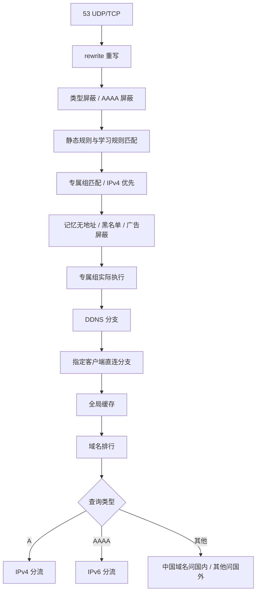

# AtomDNS 默认配置分流梳理与精简建议

> **实施状态（2026-11-05）**：第 6 节的端口清理已完成（默认只监听 53 与 API 9099，重写与刷新解析改为进程内调用，schema 7）；
> 第 5 节安全模式 S1/S2/S3/S5 已按本稿建议落地，S6（重写目标走国内）作为显式例外保留，S7 保留，S8 随适配端口一起删除；
> 第 12 节第三批的「去重」已完成（八个分流序列合并为 `process_listed.yaml` + 三个列表外序列）。
> 未做：ECS 与安全模式解耦（5.3）、非 A/AAAA 与 A/AAAA 的选路优先级对齐（第 7 节）、拆分 forward_1.yaml、清理 README-rust.md 的 Go 等价性内容。
> 对比验证见 `tools/config-diff`。以下为原审阅稿，数字和文件结构以实施前为准。


日期：2026-11-03（台北时间）  
状态：**审阅稿；仅记录现状与建议，未修改默认包、生产配置、运行状态或发布物。**

## 1. 先看结论

本次最应该先处理的，是把“安全模式”的产品含义与实际配置统一，再清理旧端口和重复序列。

1. **安全模式目前只是表外优先国外，并不保证不向国内查询。** A/AAAA、普通/刷新共八个表外流程都有“国外没有目标地址，再问国内”的分支。仅修复刚才遇到的 AAAA 一处不够。
2. **删除回退还不够。** 表外经国外查询得到国内 IP 后，会被记忆为直连；下一次可能直接问国内。需要一起约束学习、缓存、刷新和旧客户端适配入口。
3. 默认配置打开 **10 个 DNS 端口，每个同时监听 UDP/TCP，共 20 个监听插件**。生产实际全部监听。建议基础配置最终只面向客户端开放 `53`，刷新专用入口暂时保留在回环地址；其他功能按需提供。
4. `7777/8888` 当前都是直接调用国内序列；`7777` 的旧“节点专用、国外优先回退”实现已经没有入口使用。存在五个从默认监听入口不可达的序列/缓存，可优先清理。
5. **`2222` 和 `3066` 有明确内部依赖，不能直接删除。** 前者供域名重写解析目标，后者供 requery 重新探测。`3077/3099/3111` 则是带额外 DNS 查询或标签转换的客户端适配，并非简单端口别名。
6. 建议采用“基础配置 + 按需客户端适配”的结构，先保留稳定 tag、设置键、学习格式，再整理文件和内部序列。不要一次同时改逻辑、命名、持久化和 UI。

下文标记：**[保留]** 维持功能；**[修改 P0]** 优先处理的目标偏差；**[精简 P1]** 明确历史债务；**[可选 P2]** 后续优化；**[待决策]** 需要在实施前确定的产品选择。

## 2. 核查范围与证据边界

### 2.1 默认配置真正的来源

默认配置不在 AtomDNS 程序仓库的测试 YAML 中，而在相邻的 `file` 仓库：

- [默认配置根目录](/Users/tom/github/file/atomdns/config/full/config_rust)
- [主入口配置](/Users/tom/github/file/atomdns/config/full/config_rust/config_custom.yaml)
- [全量安装包构建脚本](/Users/tom/github/file/atomdns/config/full/build_config_rust_zip.sh)
- [增量配置包构建脚本](/Users/tom/github/file/atomdns/config/incremental/build_config_rust_up.sh)

核查时程序仓库 HEAD 为 `980c745a`，file 仓库 HEAD 为 `88098e7`；结论依据磁盘当前文件，不假定相邻仓库工作区一定等于 HEAD。默认根文件及 18 个子 YAML 合计 **1890 行、118 个插件声明**。

增量包直接从全量包源码目录取文件，没有第二棵维护源码。管理 `config_custom.yaml` 与 `sub_config/*.yaml`，排除自动生成的 `special_groups.yaml`；不管理 `webinfo/`、`rule/`、`gen/`、`srs/`、`cache/`、`adguard/`、`ui/`。

**[修改 P0]** 因此新默认配置不会自动清理旧机器的设置、刷新任务、缓存和学习结果。改结构时必须同时设计旧安装迁移。

### 2.2 生产与默认包的关系

只读核对 `mos`（10.0.0.3）上的 `/cus/atomdns`：

- 根 YAML 和除 `special_groups.yaml` 以外的 **17 个子 YAML，SHA-256 均与默认源码相同**。
- `special_groups.yaml` 是宿主托管生成文件，不要求与包内空模板相同。
- 生产 `flags` 覆盖：`core_mode=safe`、`client_routing=listed_direct`、`ddns_foreign=true`；其他开关按 YAML 默认值解释。
- YAML 管理端口是 `9099`，生产实际管理监听是 `80`；不能只看 YAML 认定 `9099` 是正在监听的端口。
- 生产 requery 使用 `127.0.0.1:3066`，定时任务关闭；手动触发及模式切换触发仍需保留依赖。

本次没有抓包或登录所有下游设备，**不能从“本包无引用”推断外部客户端从未使用某端口**。不可达分析是当前默认 YAML 静态引用图，不代表所有用户自定义配置。

### 2.3 文件职责与整理标注

| 文件 | 当前职责 | 整理方向 |
|---|---|---|
| `config_custom.yaml` | 主流程、刷新流程、四类监听及客户端适配 | **[精简]** 主链与适配分开，根文件只装配 |
| `settings.yaml` | 代理与 ECS 具名对象 | **[保留]** 不能覆盖用户运行设置 |
| `flags.yaml` | 13 个功能开关、UI 文案与刷新联动 | **[修改]** 安全边界、缓存例外、旧端口注释 |
| `rule_set.yaml` | 重写、规则源、名单与统一 mapper | **[保留/拆分]** 重写可独立成文件，分类 mark 先不变 |
| `adguard.yaml` | 广告规则提供者，下载引用 main_proxy | **[保留]** 与屏蔽开关及规则管理联动 |
| `route_learner.yaml` | 五类学习状态与七个学习动作 | **[修改]** safe 直连解析来源、特殊域名含义 |
| `domain_output.yaml` | 域名排行 | **[核实]** 计数位置与容量目标；不是路由学习容器 |
| `cache.yaml` | 七个具名缓存 | **[精简]** 删除不可达 cache_node，其他先保留 |
| `forward_local.yaml` | 国内上游组 | **[保留]** 与表外 safe 调用隔离 |
| `forward_nocn.yaml` | 国外上游组、3333 | **[精简]** 上游与可选监听拆开 |
| `forward_nocn_ecs.yaml` | ECS 国外组、内部序列、4444 | **[精简/待决策]** 删默认监听，ECS 策略独立决定 |
| `forward_1.yaml` | FakeIP 上游、真实解析、学习、输出、DDNS fallback、2222 | **[重组]** 当前职责过多，是主要拆分对象 |
| `process_v4.yaml` | 四份 A 分流（普通/刷新 × 国内 FakeIP 开关） | **[修改/去重]** 全部 safe 分支共同修正 |
| `process_v6.yaml` | 四份 AAAA 分流 | **[修改/去重]** 同上，保留无 V6 重新确认 |
| `process_ot.yaml` | 其他查询类型 | **[修改建议]** 选路优先级与 A/AAAA 对齐 |
| `for_singbox.yaml` | 7777、8888 与已停用节点链 | **[移出/清理]** 外部节点需求另用可选配置表达 |
| `special_groups.yaml` | 自动生成专属组入口 | **[保留]** 托管生成，不随默认包覆盖 |
| `webinfo.yaml` | 客户端名称 JSON 接口 | **[保留]** 是 WebUI 工作流依赖 |
| `requery.yaml` | 刷新插件及其状态文件引用 | **[保留/重组]** 与回环刷新入口放到一起 |

## 3. 当前主入口：一条普通查询如何执行

主入口名叫 `sequence_6666`，但实际监听 `53`。名字本身就是历史遗留。



图中的后续节点仅在前一步没有结束查询时执行。

| 顺序 | 当前行为 | 审阅标注 |
|---|---|---|
| 1 | `$rewrite` 最先执行；命中重写可直接结束 | **[保留]** 明确手工重写优先，但域名目标当前固定走国内 `2222`，见第 6 节 |
| 2 | 默认拦截 SOA/PTR/HTTPS；可另行拦截 AAAA | **[待决策]** 屏蔽 HTTPS RR 是产品策略，不是无用历史配置；PTR 全局屏蔽也影响局域网反解 |
| 3 | `!fast_mark 48` 时执行统一 mapper，叠加静态与学习事实 | **[保留]** 48 是跳过重复匹配的哨兵；不是业务分类位 |
| 4 | 专属组 matcher，随后可执行 `prefer_ipv4` | **[保留/核验]** IPv4 优先会增加分支查询；验收须覆盖辅助分支的上游 |
| 5 | 已知无 V4/V6 直接空答；黑名单 NXDOMAIN；广告 NXDOMAIN | **[待决策]** 无地址记忆优先于专属组实际执行，改变专属组后是否应再探测须明确 |
| 6 | `$sequence_special` 执行专属组 | **[保留]** 早于 DDNS、客户端强制直连和常规分流，但晚于前面的屏蔽 |
| 7 | DDNS：默认国内；开启 `ddns_foreign` 时国外优先、国内备用 | **[修改 P0/边界]** 安全模式没有约束此分支；是否视作显式例外，见第 5 节 |
| 8 | 根据客户端名单设置 mark 30，命中后直接问国内并结束 | **[保留/明确边界]** 这是显式客户端策略，优先于普通名单；不经过后面的全局缓存 |
| 9 | compat 用 `cache_all`，safe 用 `cache_all_noleak` | **[保留]** 缓存对象分开有助隔离模式；名字带 noleak 不构成防泄露保证 |
| 10 | `$top_domains` 排行计数 | **[修改 P1]** 位于全局缓存后，不能简单称作“所有客户端请求的访问计数”；调整位置会改变统计含义 |
| 11 | 按 A/AAAA、`cn_fakeip` 选择四个处理序列之一 | **[精简 P1]** 大段复制的主要来源 |

**[注意]** 主入口不是“先看安全模式，再决定一切”。安全模式只影响后面表外探测，前面的 DDNS、客户端直连、重写、专属组等仍按各自规则执行。

## 4. 名单与 A/AAAA 的实际优先级

mapper 声明顺序不等于最终分流优先级。它能同时设置多个 mark；真正选路由的是后续序列中谁先判断成功。

### 4.1 已分类域名

以下是 A/AAAA 处理内部的顺序（前提是未被第 3 节提前处理）：

| 顺序 | mark / 分类 | 当前去向 |
|---|---|---|
| 1 | 9：`realiplist`，!CN FakeIP 排除 | 国外真实解析，忽略代理域名 FakeIP 模式 |
| 2 | 10：`cnfakeipfilter` | **仅 `cn_fakeip` 开启的序列优先处理**：国内真实解析 |
| 3 | 7：灰名单 `greylist` | 代理结果：FakeIP 或国外 RealIP；学习代理 |
| 4 | 8：白名单 `whitelist` | 国内结果；学习直连 |
| 5 | 15：订阅代理 `cusnocn` | 代理结果；学习代理 |
| 6 | 13：订阅直连 `cuscn` | 国内结果；学习直连 |
| 7 | 14：非中国域名 `geosite_no_cn` | 代理结果；学习代理 |
| 8 | 16：中国域名 `geosite_cn` | 国内结果；学习直连 |
| 9 | 12：记忆代理 | 代理结果 |
| 10 | 11：记忆直连 | 国内结果 |
| 11 | 没有前述有效分类 | 表外探测 |

国内结果：`cn_fakeip=false` 时一般是 `domestic` 真实 IP；为 true 时一般是 `cnfake` 返回的国内 FakeIP。代理结果：`dns_mode=fakeip` 用 `nocnfake`；`realip` 用 `foreign`。

**[修改 P1]** 建议把上表变成正式优先级说明，尤其明确冲突时：灰名单高于白名单、订阅代理高于订阅直连、非中国域名高于中国域名、静态分类高于学习分类。不要只凭“白名单/黑名单”名称猜优先级。

**[保留]** `cn_fakeip` 与 `dns_mode` 是两条不同维度的开关。目前 RealIP 模式仍可同时开启国内 FakeIP；若准备禁止这种组合，属于新增行为变更，需要单独决策。

### 4.2 表外域名：当前最重要的问题

| 场景 | 当前第一次查询 | 无目标地址时 | 有地址后的处理 |
|---|---|---|---|
| 普通 A / compat | 国内 | 普通 A 没有刷新流程那套完整二次国外确认 | 直连 IP / 中国 IP：学习直连并保留当前答案；其他 IPv4：代理结果 |
| 普通 A / safe | 国外带 ECS | **回退国内** | 同上 |
| 普通 AAAA / compat | 国内 | rcode 0/3 且无 `2000::/3`：学习无 V6、空答 | 直连 IP / 中国 IP：学习直连；其他：代理结果 |
| 普通 AAAA / safe | 国外带 ECS | **回退国内**；再做无 V6 判定 | 同上 |
| 刷新 A / compat | 国内 | 再问国外；标记特殊域名、确认无 V4 | 按探测结果学习路由，可能返回代理结果 |
| 刷新 A / safe | 国外带 ECS | **先回国内，仍无 IPv4 再问国外** | 同上 |
| 刷新 AAAA / compat | 国内 | 无全球单播 IPv6 时做无 V6 判定 | 根据 IP 分类 |
| 刷新 AAAA / safe | 国外带 ECS | **回退国内** | 根据 IP 分类 |

每个表外场景又各有 `cn_fakeip` 开/关版本，因此安全模式的国内回退分散在 **8 个序列** 中。

**[重要纠正]** `sequence_addrealiplist_exit` 的注释像是“再向国内取真实 IP”，但实际只有 `$learn_direct_probed` 和 `exit`，**不会立即发起新的国内查询**。风险出现在它写入记忆直连之后的下一次查询；不要把注释当执行证据。

### 4.3 这次 browserleaks 的具体链路

`g5f12gaohms8.dns6.browserleaks.net` 的 A 日志标记 `unmatched_rule`；AAAA 尝试列表也符合表外安全流程：

```text
表外 AAAA
  → sequence_google_node → Google 8.8.8.8:443
  → !resp_ip 2000::/3 成立
  → sequence_local → 阿里 DoH 223.5.5.5:443 + 阿里 UDP 223.5.5.5:53
  → 之后空答，或最终再经 nocnfake → Mihomo
```

当前保留记录中该名字有 4 条 AAAA 请求过阿里，其中 3 条最后还走了 Mihomo。`.org` 命中了非中国域名列表，提前进入代理分支；`.net` 未得到同样分类。这解释了两种后缀的差别。

日志没有保留每次中间响应的完整答案，故只能依据条件与尝试链确认“未得到符合条件的 IPv6 后执行回退”，不能断定 Google 当时具体返回了哪种空答/地址。

## 5. 建议重新定义安全模式

### 5.1 按本次要求确定的最低目标

**[修改 P0，已明确方向]** 对进入表外处理的域名，安全模式只使用国外真实 DNS。国外的失败、超时、空答、不含 IPv4/全球单播 IPv6，都不能成为向国内 DNS 发送该名字的理由。普通、刷新、辅助查询、缓存刷新采用同一约束。

建议流程：

```text
表外 + safe
  → 国外真实解析（国外组内部可有多个国外备用上游）
  → 有地址：按 direct_ip/geoip 决定直连或代理
  → 无该类地址且响应正常：保留正常的 NODATA / NXDOMAIN 语义，按条件学习无地址
  → 查询失败：按 DNS 错误语义返回，不伪装成正常空答，不学习“无地址”
  → 任意上述分支均不调用 domestic
```

**[待决策，建议保留]** “只用国外解析”是否仍保留“国外 IP 命中国内段→直连”的路由判断？建议保留。**DNS 解析来源与最终流量是否直连是两件事**；表外可以通过国外 DNS 获得国内地址，而不必再次询问国内 DNS。

### 5.2 必须同时解决的旁路

| 编号 | 建议 | 原因与实现范围 |
|---|---|---|
| S1 | **[修改 P0]** 去掉全部 safe 表外→`sequence_local` 分支 | A/AAAA × cn_fakeip 开关 × 普通/刷新，八处同时修改 |
| S2 | **[修改 P0]** safe 下的表外“记忆直连”仍从国外取真实答案 | 当前 mark 11 直接进国内；只删除第一次回退无法保证下一次。最小实现可让 safe 的 mark 11 统一用国外真实解析；静态国内/显式白名单仍按更高优先级处理 |
| S3 | **[修改 P0]** 刷新不得把 safe 表外重新送国内 | 重查询不能套用“国内无解→国外补查”的兼容逻辑；保留无地址重新确认能力 |
| S4 | **[修改 P0]** 旧缓存与学习状态不能静默沿用错误策略 | 制定切换/升级时清理或重建受影响项的动作；requery 不会自动清掉学习类别，不能把它当清理工具 |
| S5 | **[待决策]** DDNS 外国优先是否也禁止国内备用 | 当前 `ddns_foreign` 明确写“国外失败回退国内”，且 fallback 阈值 1000ms，不能等同于完全国外失败后才启动。建议在 safe+ddns_foreign 下只用国外，compat 才保留国内备用 |
| S6 | **[待决策]** 重写的域名目标用谁解析 | 当前固定国内 `2222`，不看 safe；可继续作为显式重写例外，但要显示清楚。长期建议选择解析上游或走进程内序列 |
| S7 | **[保留并说明]** 专属组、显式直连客户端/名单是单独策略 | 用户明确指定国内上游时与“表外只用国外”不冲突；不能把 safe 解释为禁止任何国内 DNS |
| S8 | **[修改 P0]** 客户端适配入口不能把 safe 的表外真实答案再送国内 | 特别是 Stash 国内 FakeIP 转 realip、ClashMi 国内 FakeIP 转换；应明确区分“显式国内”与“表外经国外判成直连” |

建议 UI 文字改成“安全模式：未分类域名仅使用国外 DNS；失败不回退国内。显式指定上游的规则按各自设置执行”。不要再用笼统“防泄露更强”掩盖允许回退的事实。

安全模式不自动保证代理连接成功：当前 `main_proxy` 默认为空，即使条目有 `use_proxy:true` 也会直连国外 DNS。这里的“国外”首先约束目标 DNS 服务，是否强制经代理是另一个产品选择。

### 5.3 ECS 的建议

**[待决策 P1]** 表外安全模式目前强制携带默认 ECS `2408:8888::8`，是历史固定值，并非查询客户端的真实身份，也不是安全模式天然需要的东西。

建议保留 ECS 为可配置能力，但把“是否带 ECS”与“safe/compat”解耦；若决定默认不带，需要确认 CDN 选址影响、缓存键隔离及现有 `client_ecs` 设置迁移。**不能直接把 foreignecs 与 foreign 合并后丢掉已有设置。**

## 6. 全部端口与依赖：建议逐个处理

以下 DNS 端口当前均为 UDP+TCP，默认监听 `:端口`，不是只监听 localhost。

| 端口 | 实际入口与行为 | 内部依赖 | 建议 |
|---|---|---|---|
| **53** | `sequence_6666`，完整主分流，启用审计 | 各普通客户端 | **[保留]** 唯一默认对客户端的完整 DNS 入口 |
| **2222** | `sequence_local_in` → 国内分组缓存/国内上游；绕过主屏蔽与选路 | **rewrite 的 `dns:127.0.0.1:2222`** | **[修改 P1]** 暂改回环监听；想彻底删除需先替换重写解析依赖 |
| **3333** | `sequence_google_in` → 国外真实解析/缓存 | 本默认包未见内部调用 | **[精简 P1]** 移至可选诊断/集成配置；外部消费者待核实 |
| **4444** | `sequence_google_node` → 带 ECS 国外真实解析 | 表外流程直接调用该**序列**，不是调用该端口 | **[精简 P1]** 可移除默认监听，保留内部序列与 cache；外部消费者待核实 |
| **7777** | 当前直接 `sequence_local`，实际只问国内 | 旧 entry `sequence_sbnode` 被注释掉 | **[精简 P1]** 默认移除；需要节点解析服务时提供独立配置，明确 bootstrap 及代理循环依赖 |
| **8888** | 直接 `sequence_local`，实际只问国内，与 7777 重复 | 默认包内未见调用；可能供外部 sing-box | **[精简 P1]** 默认移除，先核实外部设备使用 |
| **3066** | `sequence_requery`，专门重新探测，默认未启用客户端审计 | **requery JSON 的 resolver_address** | **[保留/收窄 P1]** 先只监听回环；长期进程内调用需要程序改造 |
| **3077** | Stash：先完整主流程；遇国内 FakeIP 再查询国内 realip；国外 FakeIP 保留 | `sequence_for_stash` | **[精简 P1]** 移至 Stash 可选适配配置；不是普通 53 的等价端口 |
| **3099** | ClashMi：先主流程，国外 FakeIP 保留；其他有地址响应走国内 FakeIP 转换（受 mark 10 排除影响） | `sequence_local_fake_clashmi`、`cnfake`、国内 FakeIP 缓存 | **[精简 P1]** 移至 ClashMi 可选配置；转换不受 cn_fakeip 开关统一约束 |
| **3111** | sing-box：先主流程，按 FakeIP 段标注国内/国外；其他也标国内 | `sequence_for_singbox` | **[精简 P1]** 移至可选配置；目前主要是标签适配，非独立路由算法 |
| **9099 / 生产80** | HTTP API/WebUI，不是 DNS | 设置/管理、内部 URL 动作 | **[保留]** 更新过时“绑定 UI 不要改端口”注释，以有效端口为准 |

**不要误删上游地址：** `127.0.0.1:6666` 是默认国外 FakeIP 服务的目标，`127.0.0.1:1053` 是默认国内 FakeIP 服务目标，**不是本包 AtomDNS 自己提供的监听**。生产日志中的国外 FakeIP 目标是 `10.0.2.1:6666`，来自生效设置，不能只看默认 YAML。

**[修改 P1]** 所有客户端适配都硬编码了 FakeIP 网段：国外 `28.0.0.0/8`、`2001:2::/64`，国内 `30.0.0.0/8`、`2400::1/64`。它们只有在外部代理软件配置与之吻合时才正确；推荐作为可选集成的明确依赖，而不是默认内置约定。

### 6.1 可以优先清理的死分支

对所有默认 UDP/TCP 监听入口做 `$tag`、entry、fallback primary/secondary 等引用可达性检查，发现：

| 对象 | 文件 | 现状 | 标注 |
|---|---|---|---|
| `sequence_sbnode` | `for_singbox.yaml` | 无活动入口引用；7777 两处 entry 均已注释 | **[删除候选 P1]** |
| `sbnodefallback` | 同上 | 只被上面的不可达序列引用 | **[删除候选 P1]** |
| `cache_node` | `cache.yaml` | 只被不可达节点序列引用 | **[删除候选 P1]** 同步处理 settings.caches 与 UI 文案 |
| `sequence_local_fake` | `forward_1.yaml` | 无可执行引用 | **[删除候选 P1]** |
| `sequence_local_fake_pure` | 同上 | 无可执行引用 | **[删除候选 P1]** |

旧节点链本身含 `sleep 1000`，随后 fallback 阈值仅 `5ms`；与“先国外稳妥解析节点”目标也不一致。既然已不可达，不建议为了保留名字重新启用它。

这里说的删除候选仅限默认源码。用户通过外部配置/API 引用 tag 的兼容性需在发布说明中交代，不能批量删除任意机器上的同名状态。

## 7. 非 A/AAAA：当前逻辑比主分流简单得多

`sequence_other` 只有两条：mark 16（中国域名）问国内，其余问国外。它不按 A/AAAA 那张优先级表判断灰名单、白名单、订阅直连、记忆直连。

这意味着“白名单一定国内”并非对所有记录类型都成立；多分类同时命中时也可能与 A/AAAA 的有效方向不同。SOA/PTR/HTTPS 默认更早被屏蔽，MX/TXT/SRV 等仍受这两条影响。

**[修改 P1]** 建议让“选国内/国外”的策略与 A/AAAA 共用优先级，输出保留真实记录，不套 FakeIP 地址策略；专属组与 DDNS 仍在前面处理。这里是行为调整，必须验收 TXT/MX/SRV/CNAME 等类型，不能当纯重构。

## 8. 缓存、学习、刷新：精简时最容易漏的部分

### 8.1 缓存清单

| 对象 | 默认条数 | 用途 | 建议 |
|---|---:|---|---|
| `cache_all` | 100000 | compat 全局答案缓存，可能含 FakeIP | **[保留]** 先保留隔离，勿与 safe 草率合并 |
| `cache_all_noleak` | 100000 | safe 全局答案缓存，可能含 FakeIP | **[保留]** 当前未有效配置排除 FakeIP；名称不代表排除了国内结果 |
| `cache_cn` | 50000 | 国内真实查询 | **[保留]** |
| `cache_google` | 20000 | 国外真实查询 | **[保留]** 名称可改 label，优先保持持久 tag |
| `cache_google_node` | 20000 | 国外 ECS 查询，`enable_ecs:true` | **[保留/待决策]** 是否带 ECS 决定是否继续独立保留 |
| `cache_node` | 20000 | 不可达旧节点链 | **[删除候选 P1]** |
| `cache_cnmihomo` | 20000 | 国内 FakeIP | **[保留/按需]** cn_fakeip 和 ClashMi 适配可能使用 |

全部默认允许过期后继续保留 7 天、每 6 小时写盘。`lazy_cache=false` 不控制 `cache_google_node`，全局缓存又有独立开关。把分组缓存关掉不等于“没有缓存”。

**[修改 P1]** 删除有关“cache_google_node 必须保留以支持 7777”的过时注释；真实原因是表外 ECS 流程仍使用它。

**[修改 P0]** 安全策略上线需要处理旧全局答案、分组来源及后台过期刷新；不能只改新查询路径。模式变更触发 requery 会清哪些缓存，以用户保存的 JSON 为准，不能假定新包默认列表已覆盖生产。

### 8.2 路由学习与冲突

当前五类：特殊域名 mark 4（8 天）、记忆直连 mark 11（7 天）、记忆代理 mark 12（7 天）、无 V6 mark 3（1 天）、无 V4 mark 2（8 天）。数据持久化在 `gen/route_learner.json`。

- 静态规则与学习事实同时存在；不是“学习结果替代静态名单”。
- 学习直连/代理以域名为事实，A 与 AAAA 结果可能影响同名后续分流；验收必须覆盖两个类型并发。
- “国内有 IP”与“国内无 IP、国外有 IP”过去承担防污染探测；安全模式重写后，特殊域名 mark 4 的解释也需调整，不能继续把国外第一轮无 A 叫“国内无解析”。
- 学习类别在刷新中不会被全量清空，依靠 ttl 过期与重新确认。`flush_rules` 里写了学习 flush URL 不代表实际执行；程序会跳过本机 learner 类别清理。

**[修改 P0]** safe 模式不能因为旧 `my_realiplist` 而向国内 DNS 发起表外查询。优先通过 safe 下 mark 11 的查询策略修正保证约束；再决定是否分离学习来源或版本。仅等待 7 天过期不够。

**[可选 P2]** 将路由事实（直连/代理）与解析来源事实分离，是长期更清楚的模型；若需新增持久字段，单独设计兼容迁移，不塞进第一轮 YAML 清理。

### 8.3 requery 并非普通重复查询

它有单独 `sequence_requery`、独立的四个 A/AAAA 序列，故意不因无 V4/V6 记忆提前空答；还会做普通流量不做的二次确认和特殊域名学习。

**[保留]** 重新确认无地址的能力。

**[精简 P1]** 把重复主前置、名单选路、输出动作拆成共享片段；普通/刷新只保留探测和学习差异。不能直接令 3066 使用 53 主序列，否则已有无地址记忆会阻止重新探测。

**[修改 P1]** 全新安装包目前附带历史 requery 状态：2025 年起始时间、上次任务 `failed`、旧域名数和进度等。建议全新包提供干净模板，默认不自动跑旧任务；已有安装不覆盖用户计划。默认 SRS 描述 JSON 也携带旧计数/更新时间且关闭自动更新，README 应解释它们是种子资料；是否首启更新另作选择。

## 9. 默认开关逐项建议

| 开关 | 当前默认 | 建议 |
|---|---|---|
| `core_mode` | compat | **[待决策]** 先把 safe 做到名实相符；是否新安装默认 safe 单独决定，不擅自切换现有用户 |
| `dns_mode` | fakeip | **[待决策]** 依赖外部 6666 服务；若面向纯后端用户，应有 RealIP 独立可用模板或安装说明 |
| `cn_fakeip` | false | **[保留]** 国内 FakeIP 作为按需功能 |
| `prefer_v4` | false | **[保留]** 验收辅助 A 分支也不能突破 safe 约束 |
| `ddns_foreign` | false | **[修改/待决策]** 名称、文案与失败回退策略一致；生产此项为 true |
| `block_empty` | true | **[保留]** 学习仅从正常无答案确认，不能把超时当无地址 |
| `block_blocklist` | true | **[保留]** |
| `block_qtypes` | true | **[待决策]** 建议将 HTTPS 与 SOA/PTR 分开讨论，不顺带删除现有行为 |
| `block_ads` | true | **[保留]** 规则下载是否走代理由 main_proxy 决定 |
| `block_aaaa` | false | **[保留]** |
| `full_cache` | true | **[保留]** |
| `lazy_cache` | true | **[保留/改文案]** 清楚说明不控制 ECS 查询缓存 |
| `client_routing` | none | **[保留]** 当前两种有名单模式实际是在决定哪些客户端强制直连，不是把其他客户端所有域名强制代理 |

**[修改 P1]** `flags` 名称和 option 值留在 `settings.json`，不能为整理文案直接改 key。删除 cache_node、合并 foreignecs 等同理：旧 settings 中引用不存在对象可能使加载失败，须先迁移。

## 10. 建议的文件结构

以下仅为候选结构，不是已实现的配置，也不表示现在支持新的 include 扩展语法。

```text
config_custom.yaml          日志、API、include；仅基础监听
sub_config/
  settings.yaml             代理、ECS 具名对象
  flags.yaml                稳定开关键与说明
  rule_set.yaml             静态分类、统一 mapper
  route_learner.yaml        路由学习类别与规则
  cache.yaml                必需缓存
  upstreams.yaml            domestic / foreign / foreignecs / FakeIP 组
  routing_common.yaml       屏蔽、专属组、DDNS、客户端策略等共享步骤
  routing_policy.yaml       名单优先级、compat/safe 表外探测
  response_policy.yaml      国内/代理 RealIP/FakeIP 输出
  refresh.yaml              requery 差异、插件、回环3066
  rewrite.yaml              重写及暂留回环2222
  domain_output.yaml        排行
  adguard.yaml              广告源
  webinfo.yaml              客户端名称等状态
  special_groups.yaml       继续由程序生成，包不覆盖
optional/
  stash.yaml                可选3077
  clashmi.yaml              可选3099及其专用转换
  singbox.yaml              可选3111
  upstream_test.yaml        可选3333/4444等诊断入口
```

**[建议 P1]** 第一轮先删除死分支、移出可选监听、消除行为问题，再做文件重命名。引用图和评审更容易核对。

**[保留]** tag、label、mark、API 路径、dump_file、学习状态格式是不同层次的标识。优先只改注释/label 与文件组织；例如 `sequence_6666` 改名 `main` 虽然更直观，也要核对审计 final_sequence、外部引用及验证记录，不能混同为纯排版。

**[修改 P1]** 可选适配需要明确“如何启用和升级”。当前增量包只收集 sub_config 顶层 YAML；直接新建 optional/ 不会自动获得包管理支持。可以通过包内可选模板 + 明确手工 include，或以后再增加产品开关实现；实施时选择一种受支持的机制。

## 11. 历史文件与说明文档

- **[精简 P1]** README-rust.md 仍以 Go config_all 等价性为核心，并包含过时的“逐字节相同”、上游并发说明、旧路径及手工 zip 步骤。改成当前 AtomDNS 的安装、模式边界、上游依赖、可选集成、升级迁移说明；历史等价性留到迁移记录。
- **[精简 P1]** 新安装模板不必继续携带 switch1–17 示例作为常规设置；但旧安装的一次迁移逻辑不能移除，且要保证 `flags:{}` 的迁移标记。
- **[待核实 P2]** rule/ 中 hosts、redirect、pcdn、旧 googlev6 等遗留样例是否仍被 UI 或脚本消费。不能仅因 YAML 没引用就删除用户规则文件。当前 rewrite 实际读取 `rule/rewrite.txt`。
- **[精简 P1]** 日志文件名 `/tmp/mosdns.log` 可在新模板改为 AtomDNS 名字，但旧日志采集脚本、服务约定应记录；这不是路由修复的前置条件。
- **[保留]** `special_groups` 名称与托管边界；不重新引入 route_group，也不手工重写生产生成文件。
- **[修改 P1]** 全量安装包不要携带旧运行状态；增量包不要扩张 managed_files 去覆盖用户数据。提供迁移动作，而不是打包整份生产目录。

## 12. 分批修改建议与验收

### 第一批：安全语义修正（P0）

范围：八处表外回退、safe 下记忆直连、刷新一致性、旧状态处理；明确 DDNS/重写/客户端适配例外。

建议在配置评审时这样标注原逻辑（这是说明片段，不是可直接部署补丁）：

```yaml
# [删除 S1] 安全模式没有该类地址时，不能向国内补查
# - matches:
#   - flag core_mode=safe
#   - "!resp_ip 2000::/3"    # A 的对应位置是 !resp_ip 0.0.0.0/0
#   exec: $sequence_local

# [补齐 S2] safe+记忆直连：保留“直连”路由决定，解析来源仍是国外
# 具体共享序列及审计标签在设计时确定；不是直接把 mark 11 改成“代理”
```

验收以 **所有上游尝试和辅助/后台分支** 为准，不只看 final_upstream：

| 场景 | 预期 |
|---|---|
| safe 表外 A/AAAA，国外正常有地址 | 全部真实解析尝试仅国外；按 IP 决定路由 |
| safe 表外 NODATA/NXDOMAIN | 保持 DNS 语义，不向国内探测 |
| safe 表外国外超时/SERVFAIL/REFUSED | 错误响应、不向国内探测、不学习为无地址 |
| safe 表外只返回非 `2000::/3` 的 IPv6 | 不回退国内；地址处理策略明确，避免误学局域网名字 |
| safe 表外经国外得到国内 IP，第二次查询 | 即使记忆直连也不向国内解析 |
| safe 表外并发 A/AAAA、prefer_v4 | 各分支都遵守来源约束 |
| 普通流量、requery、过期缓存刷新 | 采用一致安全约束 |
| compat 对照 | 原有兼容策略仍可用，变更范围明确 |
| 显式国内名单/客户端/专属组/重写/DDNS | 按评审决定的例外规则验证 |
| safe+FakeIP | AtomDNS 真实探测不向国内；外部 FakeIP 服务自己的 DNS 来源另行验证 |

### 第二批：监听与死分支清理（P1）

- 清理五个不可达对象及关联说明；迁移引用这些对象的 settings。
- 将 2222、3066 收窄至回环，保留 UDP/TCP 所需协议。
- 默认去掉 7777、8888、3333、4444 监听；保留仍被主链直接使用的内部序列。
- 3077、3099、3111 移至明确可启用的可选配置，删除前检查外部设备配置。
- 验收重写域名目标、手动刷新、模式切换触发刷新、可选适配和真实监听清单。

### 第三批：去重和模板整理（P1/P2）

- 共用选路/输出策略，减少四份普通 + 四份刷新序列的大段复制。
- 统一非 A/AAAA 的名单优先级；保留必要的刷新差异。
- 清理旧注释、默认状态、规则样例和 README。
- ECS、全局缓存合并、学习来源模型等另行设计，不强塞进同一次调整。

### 发布与迁移门槛

结构/行为调整按项目规则更新配置 schema、package ID 与匹配程序元数据；当前为 schema 6 / `rust-config-schema-6`，下一版编号在实施时确定。

必须覆盖全量新装与 schema 6 旧装升级两条路径。逐项核对已有 `settings.json` 的 flags/upstreams/caches/learning、requery JSON、学习与缓存持久化、可选客户端端口；不能通过覆盖整个 webinfo 或 gen 来实现迁移。旧配置文件是否删除通过 manifest 明确表达。

后续如需构建/测试，Rust 检查在 `mosdns-rust` 远程构建机进行；本次只读审计和文档整理，无 cargo 构建、无部署、无发布。

## 13. 审阅时建议先确认的六项选择

1. **安全模式边界：** 建议表外真实解析永不问国内，包含记忆直连、刷新与后台分支；显式国内规则作为清楚标注的例外。
2. **DDNS：** 建议 safe+国外解析关闭国内 fallback；compat 保留现有备用策略。
3. **默认端口：** 建议基础对外只开放 53，内部回环 2222/3066；其他按需启用。
4. **ECS：** 建议与安全模式解耦；是否默认不带 ECS 需权衡 CDN 选址，不直接删除现有配置键。
5. **默认 DNS 模式：** 是否仍默认 FakeIP 并要求外部服务，或为独立使用提供默认 RealIP 方案。
6. **类型屏蔽：** 是否继续默认一起屏蔽 SOA/PTR/HTTPS，还是以后拆分；不与安全修复混做。

以上为修改建议，均等待本轮审阅收敛后再形成实际配置补丁。

## 14. 复核依据

关键默认源码定位：

- `config_custom.yaml:31` 主入口；`:137` 刷新入口；`:228` Stash；`:257` ClashMi；`:288` sing-box。
- `sub_config/process_v4.yaml:50`、`:108` 普通表外；`:167`、`:239` 刷新表外。
- `sub_config/process_v6.yaml:36` 普通 AAAA 的安全回退；其余 cnfake/requery 版本有同构分支。
- `sub_config/forward_1.yaml:118` 国内解析；`:129` 仅学习直连并退出；`:136`、`:167` 无引用候选；`:348` DDNS fallback。
- `sub_config/for_singbox.yaml:3`、`:11` 死节点链；`:22`、`:29` 被注释的入口；7777/8888 实际均调用 sequence_local。
- `sub_config/rule_set.yaml:103` 起的 mapper 配置；`sub_config/route_learner.yaml` 学习类别及条件。
- `sub_config/cache.yaml` 七个缓存；`webinfo/requeryconfig.json` 安装包刷新模板。

运行时契约与代码交叉核对：

- [配置说明](../ai/config-notes.md)：配置包边界、flags、学习与 mark 48。
- [具名设置契约](contracts/native-settings.md)：空代理、上游覆盖与缓存/学习设置。
- [功能开关契约](contracts/native-feature-flags.md)：迁移标记、requery 联动与生成配置依赖。
- [刷新契约](contracts/native-requery.md)：resolver_address、内部 URL、本机学习 flush 被跳过。
- [重写实现](../../rust/native-host/src/rewrite.rs)：域名目标通过配置的 DNS 服务器查询，不能假定已支持直接指定内部序列。
- [执行实现](../../rust/native-host/src/execution.rs)：有效标签与上游尝试、分支行为，不能只凭 domain_set 或最终标签判断是否向国内发过请求。

未做的验证：删除端口后的实际下游兼容、重构配置启动、网络失败注入、候选新策略端到端。此文档是源码和当前日志支持的审阅结论，不是已完成上线验证的报告。
